# railhead-17m

A **17M-parameter System-1 decision model** for [Railhead](https://github.com/rachittshah/railhead), the
OpenTTD environment: given a company's wake-up state, it scores which air route to build now (or to hold),
in about a millisecond-scale forward pass on Apple silicon. It starts from
[Bekko System One v0 17M](https://huggingface.co/hotchpotch/bekko-system-one-v0-17m) (Ettin/ModernBERT
encoder, shared-prefix option branches), ported to native MLX, and is fine-tuned on **simulator
counterfactual labels**: every option is actually built in a fork of the game and played forward.

Status: work in progress. Results land in `runs/` and in the tables below as they are measured.

## Looped variant: the 17M made a looped transformer by editing its weights (2026-11-21)

`rh17m loop-edit` turns the trained model into a **looped transformer** without any gradient step. Layer 0
stays as it is; layers 1-3 and 4-6 become **one shared (sliding, sliding, full) block applied twice**. The
export stores layers 4-6 as byte-identical copies of 1-3. Full write-up, with the maths, every variant and
the tuning history: **[docs/loop-edit.md](docs/loop-edit.md)**.

**Interactive explainer: [rachittshah.github.io/railhead-17m/explainer](https://rachittshah.github.io/railhead-17m/explainer/)**
(source in [`docs/explainer`](docs/explainer)). It follows three real decisions through both models in your
browser:
- switch between the original and looped models, and run the shared block 1 to 8 times;
- see each option's rank move layer by layer;
- open any layer for its real attention maps, the state text each option reads, and its MLP units;
- read a step-by-step account of how the edit was made.

<p align="center"><a href="https://rachittshah.github.io/railhead-17m/explainer/"><picture>
  <source media="(prefers-color-scheme: dark)" srcset="docs/figures/explainer/explainer-dark.jpg">
  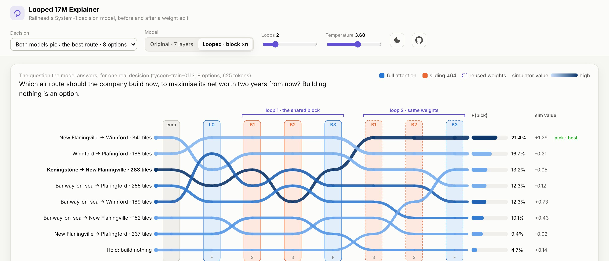
</picture></a></p>

<details><summary>Recording: switching models, running 1-8 loops, inspecting a layer's attention</summary>
<p align="center">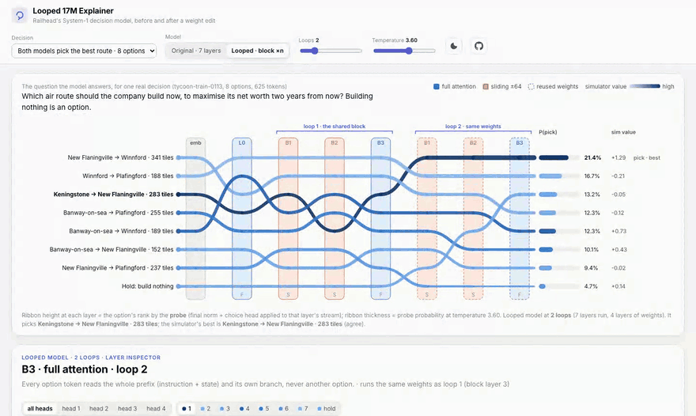</p>
</details>

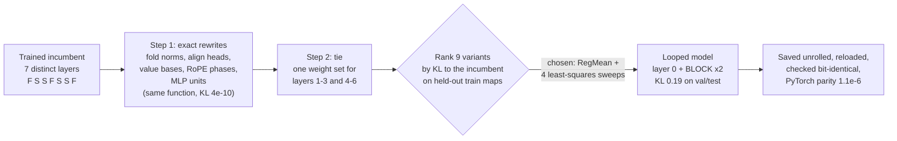

**The model, before and after.** Layer types, attention windows and parameters per layer, drawn from the
real config. Loop 2 is dashed because it holds no weights of its own.

<p align="center"><picture>
  <source media="(prefers-color-scheme: dark)" srcset="docs/figures/loop-edit/architecture-dark.svg">
  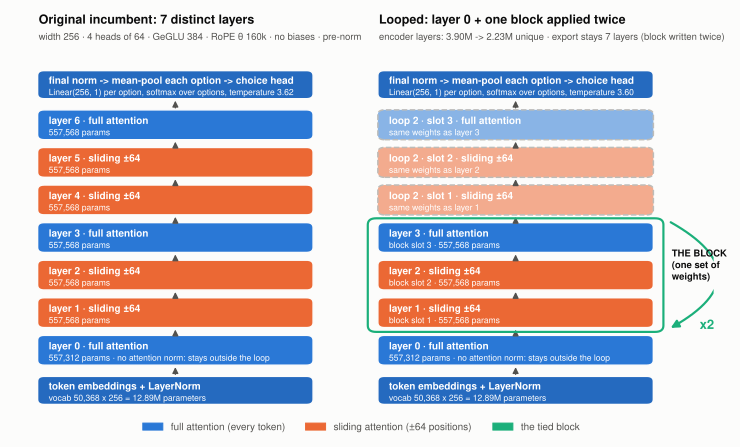
</picture></p>

**One decision through both models.** Each point is one of 8 options, followed layer by layer; darker means
higher simulator value and the ring marks the best option. Original on the left, looped on the right.

<p align="center"><picture>
  <source media="(prefers-color-scheme: dark)" srcset="docs/figures/loop-edit/trajectory-dark.gif">
  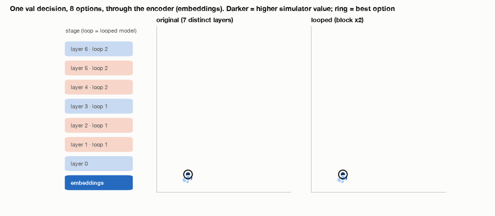
</picture></p>

**Step 1, aligning the two blocks.** Trained blocks can't be compared until their heads and neurons are
matched. Head matching for each layer pair, with the chosen pairing boxed (layers 1 and 4 match in reverse
order):

<p align="center"><picture>
  <source media="(prefers-color-scheme: dark)" srcset="docs/figures/loop-edit/head-match-dark.svg">
  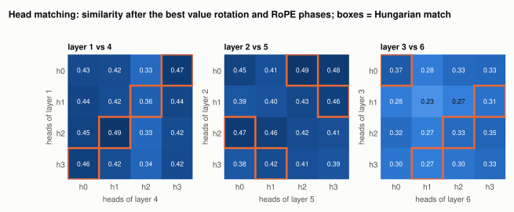
</picture></p>

The 384×384 MLP neuron comparison looks like noise as trained, and a diagonal appears after reordering;
about half the gate signs flip (195, 181 and 179 of 384):

<p align="center"><picture>
  <source media="(prefers-color-scheme: dark)" srcset="docs/figures/loop-edit/neuron-match-dark.svg">
  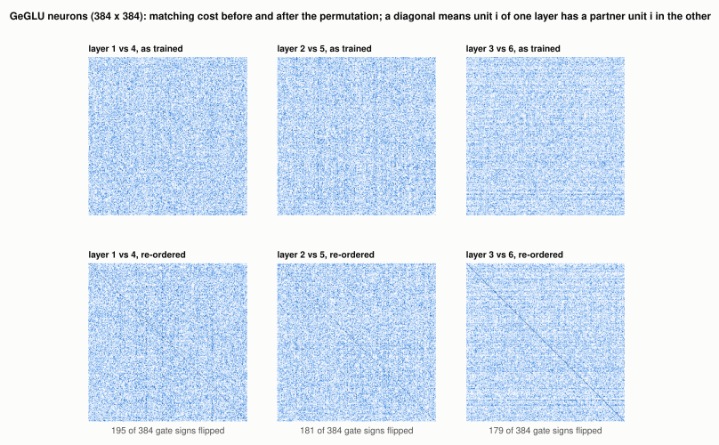
</picture></p>

**Step 2, tying the blocks.** All 9 ways of tying them, ranked by KL to the original on held-out train maps.
Ties made from the weights alone (copying or averaging the blocks) give KL 0.68-0.89. RegMean gives 0.40,
and four least-squares sweeps on the looped model's own activations bring it to 0.14:

<p align="center"><picture>
  <source media="(prefers-color-scheme: dark)" srcset="docs/figures/loop-edit/variants-dark.svg">
  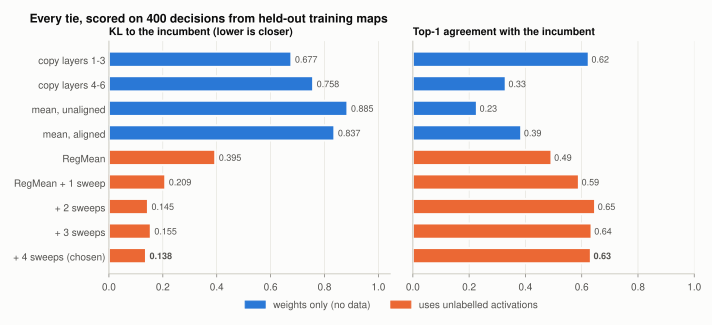
</picture></p>

Where each version drifts from the original, layer by layer. The weights-only copy is exact in loop 1 and
ends at 0.38 relative error; the chosen edit stays below the plain merge at every layer and ends at 0.12:

<p align="center"><picture>
  <source media="(prefers-color-scheme: dark)" srcset="docs/figures/loop-edit/stream-error-dark.svg">
  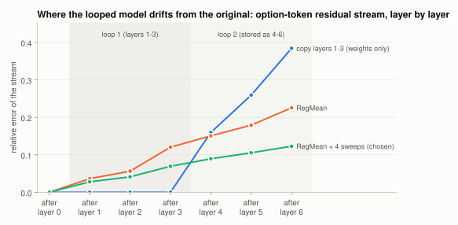
</picture></p>

**It is a real loop.** The same block run 1 to 8 times: KL stays between 0.138 and 0.158 from 2 loops on,
and the change per extra loop shrinks from 0.54 to 0.058, so the state settles instead of blowing up.

<p align="center"><picture>
  <source media="(prefers-color-scheme: dark)" srcset="docs/figures/loop-edit/fixed-point-dark.svg">
  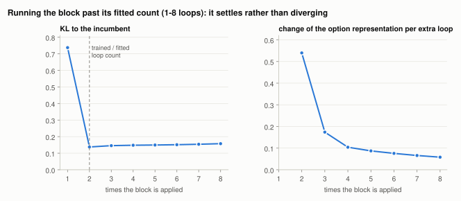
</picture></p>

**Results on the incumbent** (`runs/loop/1023-1627-base-s1-loop2`):

| | val | test |
|---|---|---|
| KL to the original | 0.19 | 0.19 |
| top-1 agreement with the original | 0.58 | 0.59 |
| regret, looped minus original [95% interval, maps resampled] | +0.007 [-0.046, +0.030] | +0.020 [-0.024, +0.073] |

Neither regret difference is significant. The encoder's unique layer weights drop from 3.90M to 2.23M; the
embeddings (12.89M) are unchanged. **Not run yet: the closed-loop gate**, so the looped model is not a
replacement for the incumbent.

<p align="center"><picture>
  <source media="(prefers-color-scheme: dark)" srcset="docs/figures/loop-edit/regret-dark.svg">
  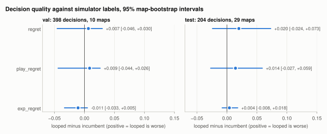
</picture></p>

The write-up has all 14 figures (each in light and dark), the animation and 6 flowcharts;
`rh17m loop-figures` regenerates them from a run.

## Results so far (2026-10-23, incumbent `1023-1627-base-s1`)

**Closed loop**, 11 held-out 512x512 dev maps (10-year games + run-off), one seed per map, a decision every 180
days, player `play-v3` (falls back to the next option when a build fails without spending; routes and
"add planes" expansions). Arena score is Railhead's `tycoon_log` (saturates at 1.0 on rich maps).

| policy | mean arena score | mean asinh(final net worth / £100k) | model wins (maps) |
|---|---|---|---|
| **railhead-17m** | **0.735** | **4.213** | |
| random option | 0.733 | 4.227 | 6/11 |
| always longest route | 0.665 | 3.656 | 6/11 |
| hold (do nothing) | 0.000 | | |

Second closed-loop suite (2026-10-23, `runs/play-devhub/summary.json`: 26 Hub dev maps of 256x256, 14 with a
5-year mandate and 12 with a 1-year mandate, 2 seeds each, paired bootstrap on asinh net worth): the incumbent vs random is +0.171 [-0.231, +0.529],
and vs longest +0.269 [-0.120, +0.614]. Neither is significant. The closed-loop gate (`runs/climb/gates.jsonl`)
rejected both distilled candidates against the incumbent: self-distilled -0.405 [-0.787, -0.036] and
ensemble-distilled -0.440 [-0.836, -0.074]. Distillation improved val regret but hurt closed-loop play.

**The ceiling** (2026-11-10, `runs/play-oracle-devhub/summary.json`, same 26 maps, same 2 seeds, paired). The
`oracle` policy values every option with the simulator at each wake-up (one rollout seed, 728 days) and plays
the best one. It is a lower bound on what this action space allows.

| policy | mean asinh(net worth / £100k) | median net worth | vs random [95% interval, maps resampled] | maps won vs random |
|---|---|---|---|---|
| oracle | 2.892 | £1,126,158 | +0.918 [+0.604, +1.213] | 25 of 26 |
| railhead-17m | 2.144 | £508,530 | +0.171 [-0.231, +0.529] | 19 of 26 |
| random option | 1.973 | £441,479 | | |
| always longest route | 1.876 | £410,425 | -0.098 [-0.289, +0.090] | |

The oracle beats the model by +0.747 [+0.452, +1.082] and wins 24 of 26 maps. The model captures 19% of the
oracle's gain over random, which agrees with the offline `capture` of about 0.2. So the labels and the action
space carry value that the evaluation can see, and the model is the bottleneck. Over 373 oracle decisions the
best option is a new route in 48%, more planes in 37% and hold in 15%; the fork predicted the live build in
316 of 316 checks.

One map, one seed, for scale against the frontier models: on `arena-dev-0100` (Railhead's Arena 2 world) the
model ends at £10.4M, random at £7.1M and always-longest at £7.3M (`runs/play-arena0100/`). Claude Opus 5.5
reached £45.8M on that map by laying every tile itself; the policies here choose from a menu and a scripted
builder places the airports, so the two are not like for like.

The 11 local ten-year maps, one seed (`runs/play-oracle-local/summary.json`), agree: oracle vs random +1.277
[+0.547, +2.462], oracle vs model +1.291 [+0.506, +2.490]; median net worth £15.2M, £5.3M and £8.0M.

**Search at decision time** (2026-11-10, `runs/play-search-devhub/compare.json`, the same 26 maps and seeds).
`search:k` lets the model rank the options, simulates only its top k (plus hold) with the oracle's own
valuation, and plays the best of those. `search:k:random` is the control: k random options instead of the
model's.

| policy | vs random [95% interval] | share of the oracle's gain | options simulated per decision | seconds per decision |
|---|---|---|---|---|
| oracle | +0.918 [+0.604, +1.213] | 1 | 10.8 | 30.0 |
| search:3 (model's top 3) | +0.598 [+0.290, +0.899] | 0.65 [0.45, 0.79] | 3.8 | 10.8 |
| search:3:random (control) | +0.521 [+0.318, +0.754] | 0.57 [0.41, 0.76] | 3.7 | 8.7 |
| search:2 (model's top 2) | +0.440 [+0.203, +0.694] | 0.48 [0.30, 0.62] | 2.9 | 7.1 |
| railhead-17m alone | +0.171 [-0.231, +0.529] | 0.19 [-0.31, 0.48] | 0 | 0.3 |

Three simulated options recover about two thirds of the oracle's gain at about a third of its cost. Most of
that comes from the lookahead, not from the model: with the model choosing the candidates the gain over the
random control is +0.077 [-0.147, +0.243], 19 of 26 maps won. So the simulator is where the value is today,
and the model is a weak prior. The oracle and search games also valued about 1,300 decisions under a good
policy's state distribution. They cannot be trained on: every one sits on a dev map, which `map_split` calls
`test` and which the closed-loop suites play. The next training round needs the same policies run on the
training maps.

**Offline**, simulator-valued decisions (asinh units; 0.1 is about 10% of net worth at the horizon):

| split | n | model regret | model play_regret | longest regret | longest play_regret | uniform play_regret |
|---|---|---|---|---|---|---|
| val | 128 | 0.210 | 0.190 | 0.258 | 0.223 | 0.480 |
| test | 82 | 0.316 | 0.295 | 0.635 | 0.568 | 1.070 |

`play_regret` replays the closed-loop player offline (options in the model's order, skipping builds that
failed). Hillclimbing (`runs/climb/ledger.jsonl`) uses seed-matched 3-seed comparisons with an A/A control per
pass. At this data size (≈800 decisions) no setting change has survived. Four moves passed the offline bar
(tau 0.1, self-distillation, `expansions: false`, `freeze_embeddings`), and all four were reverted: the
closed-loop gate rejected distillation, and pass 8's keeps were a val-definition artifact. Data and the action
space (expansions, continuation policy) have moved results; settings have not. Status as of 2026-10-24:
`lbl-v4` labels (rollouts keep adding planes after the option) and DAgger are part of the pipeline, and
distillation is moved last behind the closed-loop gate. The pipeline has been paused since 2026-10-24.

## How the labels are made

```
decision state (savegame)                       options: 8 air candidates (routes-v1) + hold
        │
        ├── fork ─ build option (cash ladder: large/2, small/2, commuter/2, large/1, small/1, commuter/1)
        │            └── save ─┬─ reseed s1 ─ step 8 x 91 days ─ net worth curve
        │                      ├─ reseed s2 ─ ...                 (same seeds for every option:
        │                      └─ reseed s3 ─ ...                  common random numbers)
        └── value(option) = mean_s asinh(net worth at min(728 days, end of game) / £100k)
            target = softmax(value / tau)
```

- **States**: verified replays of frontier-model games (Railhead seed games, Hub Arena games), task starts,
  and scripted self-play (random / longest / mixed policies) on 25 local 512x512 maps and 151 Hub maps.
- **Splits by map**: `arena-dev-*` = test, `arena-train-0227/0228/0229` = val, other train maps = train.
- **Throughput** (M4 Max): fork 0.7 s, a 365-day step 1.0 s on a fresh map and 1.8 s at 148 vehicles;
  394 labelled states/h with 22 workers (2026-10-24: mixed 1-seed train and 3-seed eval jobs). 10-minute
  windows on 2026-10-29 (`runs/sweep/*.jsonl`, 14 workers, 1-seed jobs only) gave 906/h on the stock path and
  1,650/h with the opt-in server pool and pipelined site search.

## The model

- `src/rh17m/bekko_mlx/`: native MLX Bekko-17M (inference + training), parity-tested against the published
  PyTorch runtime (see `docs/bekko-mlx.md`).
- Input: the wakeup-v1 rendered state (railhead-system1) as JSON, one choice question, options described in
  text (towns, populations, length, cost estimate vs cash). The same `dataset.observation` text is used in
  training and in closed-loop play.
- Training: soft-target cross-entropy, AdamW (encoder 1e-4, heads 5e-4), option-order shuffling and both
  prefix layouts as augmentation, epoch selection on val expected regret, temperature fitted on val NLL.

## Metrics

Offline, against simulator values (asinh units; 0.1 is about 10% of net worth at the horizon):
`regret` (best minus picked), `exp_regret` (under the model's distribution), `capture` (share of the best
option's edge over a random pick), `hit` (pick within seed noise of the best), `nll`, `ece`.
Closed loop: full games on held-out maps, Railhead's arena score (`tycoon_log`).

## Reproduce

```bash
uv venv --python 3.12 .venv && uv pip install -e '.[dev]'
.venv/bin/rh17m tasks                      # Hub tasks -> data/tasks
scripts/launch.sh                          # tmux session rh17m: harvest, label (train/val/test), observe, play, watch, dashboard
scripts/stop.sh                            # stop every stage cleanly (all stages resume on relaunch)
.venv/bin/rh17m baselines                  # scripted policies on the labelled decisions
.venv/bin/rh17m train --name v1            # one training run -> runs/train/v1
.venv/bin/rh17m climb                      # hillclimb with a noise floor -> runs/climb/ledger.jsonl
.venv/bin/rh17m play --tasks arena-dev-0212 --policies longest model --model runs/train/v1/model
```

## Credits

Bekko System One (MIT trainer, model by hotchpotch), Ettin rerankers (Apache-2.0), Railhead and
railhead-system1 (contract, candidates, snapshot, air builder), decision-mlx (MLX decision-model harness).
