# Loop edit: making the 17M decision model a looped transformer by editing its weights

**Status (2026-11-21):** done. `rh17m loop-edit` turns the incumbent (`1023-1627-base-s1`) into a looped
transformer with no gradient step. The export is `runs/loop/1023-1627-base-s1-loop2/model`. It is layer 0
followed by one three-layer block applied twice. After reload, layers 4–6 are byte-identical to layers 1–3,
in MLX and in the published PyTorch runtime.

The edited model is close to the incumbent but not the same model. On val and test it picks the incumbent's top
option 58–59% of the time (KL 0.19). Its regret is not significantly different, but val is too weak to
separate the candidates (see [What the labels say](#what-the-labels-say)). The closed-loop gate has not been run.

- Code: `src/rh17m/loopedit.py`, CLI `rh17m loop-edit` (`src/rh17m/cli.py`), map-level bootstrap
  `evaluate.cluster_bootstrap_diff`.
- Tests: `tests/unit/test_loopedit.py` (12 tests). The full unit suite is 165 passed.
- Run record: `runs/loop/1023-1627-base-s1-loop2/{config.json,results.json,run.log}`. The weights are
  git-ignored (`runs/loop/*/model/`).
- Figures: `docs/figures/loop-edit/`, each in a light and a dark version, regenerated by `rh17m loop-figures`
  ([Section 15](#15-figures-and-how-they-are-made)).

### At a glance

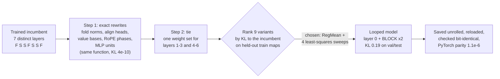

The animation follows one real val decision with 8 options through the encoder. Each point is one option's
representation: the mean of its branch tokens, after the final norm, projected to the two main directions of
both models' states. Darker points have higher simulator value, and the ring marks the best option. The left
panel is the original model and the right the looped one. Both take the same overall path; they differ in
the last steps, where the looped model orders the options a little differently.

<p align="center"><picture>
  <source media="(prefers-color-scheme: dark)" srcset="figures/loop-edit/trajectory-dark.gif">
  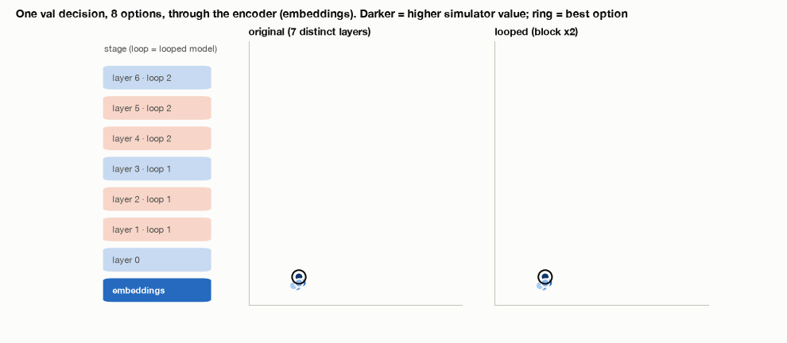
</picture></p>

Contents:

1. [What a looped transformer is, and why try one here](#1-what-a-looped-transformer-is-and-why-try-one-here)
2. [The model being edited](#2-the-model-being-edited)
3. [Which layers become the loop](#3-which-layers-become-the-loop)
4. [Step 1: exact rewrites that change no output](#4-step-1-exact-rewrites-that-change-no-output)
5. [Step 2: tying the blocks](#5-step-2-tying-the-blocks)
6. [Data, splits and how a variant is chosen](#6-data-splits-and-how-a-variant-is-chosen)
7. [Results](#7-results)
8. [Verification](#8-verification)
9. [Tuning history (every run made)](#9-tuning-history-every-run-made)
10. [Reproduce](#10-reproduce)
11. [Code map](#11-code-map)
12. [Limitations and threats to validity](#12-limitations-and-threats-to-validity)
13. [What to do next](#13-what-to-do-next)
14. [References](#14-references)
15. [Figures and how they are made](#15-figures-and-how-they-are-made)

---

## 1. What a looped transformer is, and why try one here

A standard transformer applies L distinct layers once each. A **looped** (weight-tied, recurrent-depth)
transformer applies one block of layers several times. Depth comes from repetition, not from new parameters.
Recent work reports that looped models match deeper untied ones with far fewer parameters:

- Yang et al. 2023: looped models match standard ones on in-context learning with under 10% of the parameters.
- Looped Actor 2026: a looped RL policy matches an untied baseline with 16x the parameters, with the largest
  gains where action choice needs multistep planning.
- Truncate or Not? 2026: two fully trained loops is the best looped setting, ahead of the compute-optimal
  non-looped model with about 27% fewer non-embedding parameters.

The papers also show the depth can be **retrofitted** onto a pretrained model, not only trained from scratch
(Retrofitted Recurrence 2025, Closing the Loop 2026, Skip a Layer or Loop It? 2025). Those papers retrofit
with continued training. The request here was narrower: **edit the weights directly**, with no gradient step,
until the 17M model is a loop transformer.

Expectations were set before the work started:

- **Extra depth is probably not the bottleneck.** The 68M teacher (19 layers, width 512) scored 0.303
  val expected regret on the same labels against about 0.31 for the 17M. Climb pass 1 was data-bound.
- **Parameter savings barely matter.** 12.9M of the 16.8M parameters are the token-embedding table. Tying
  saves only within the 3.9M of layer weights.

So the edit is valuable as a structural change, a starting point for a looped fine-tune, and a probe of
whether the two blocks compute something similar. It is not expected to beat the incumbent by itself.

## 2. The model being edited

The incumbent `runs/train/1023-1627-base-s1/model` is Bekko System One v0 17M (hotchpotch, MIT trainer) on
an Ettin / ModernBERT encoder (Apache-2.0), fine-tuned here on simulator counterfactual labels. It is
**encoder-only** and bidirectional, not a generative model.

| Field | Value |
|---|---|
| Architecture | `ModernBertModel` (`backbone_config.json`) |
| Layers | 7 |
| Hidden width | 256 |
| Attention heads | 4 (head dim 64) |
| MLP | GeGLU, `intermediate_size` 384, so `Wi` is 768 x 256 and `Wo` is 256 x 384 |
| Layer types | full, sliding, sliding, full, sliding, sliding, full (`global_attn_every_n_layers` 3) |
| Sliding window | `local_attention` 128, so a sliding query reads keys within ±64 positions |
| Positions | RoPE, theta 160,000 for both layer kinds |
| Biases | none (`attention_bias`, `mlp_bias`, `norm_bias` all false) |
| Norms | pre-norm LayerNorm without bias; **layer 0 has no attention norm** (`nn.Identity` in the checkpoint) |
| Vocabulary | 50,368 tokens; embeddings tied to the (unused) MLM decoder |
| Heads | three `Linear(256, 1)` task heads: `choice`, `noul`, `score`; decisions use `choice` |
| Temperature | 3.624, fitted on val NLL at training time (`rh17m.json`) |

Parameter count, from the safetensors:

| Group | Parameters |
|---|---|
| Token embeddings (+ embedding norm) | 12,894,464 |
| The 7 encoder layers | 3,902,720 |
| Task heads, final norm | 1,027 |
| **Total** | **16,798,211** |

**How a decision is scored** (`bekko_mlx/model.py`, `BekkoMLX.pooled`):

- The instruction and state are encoded once as a bidirectional **prefix**.
- Each option is a separate **branch**. At every layer a branch token reads the prefix keys and values of that
  same layer plus its own branch, never another option's. Branch positions continue after the prefix.
- The prefix is never updated in the last layer, because no option reads that update.
- Each option's representation is the mean of its final-normed branch tokens. The `choice` head maps it to
  one logit, and a softmax over options gives the policy.

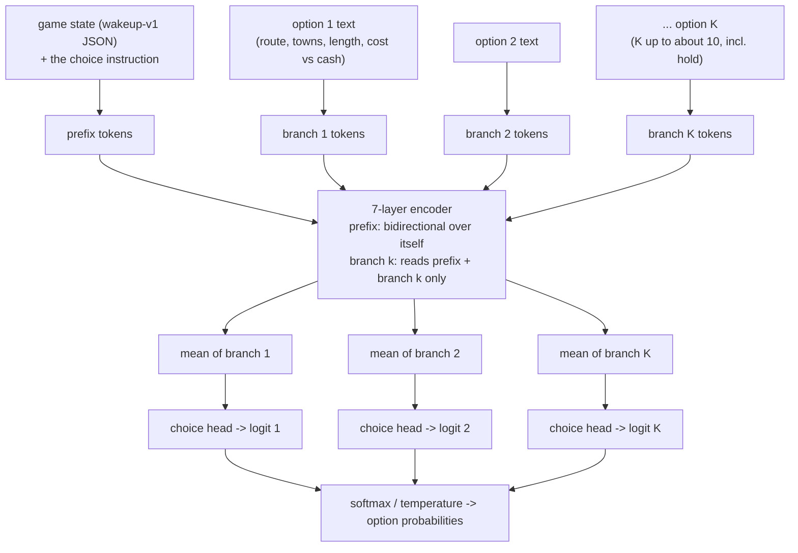

The attention layouts below come from the model's own mask code (`BekkoMLX._masks`) on a real val decision
with 8 options: 270 prefix tokens and 355 option tokens.

- **Full-attention layers (0, 3, 6):** every prefix token reads the whole prefix. Each option token reads the
  whole prefix and its own branch (the blocks on the diagonal), and never another option.
- **Sliding layers (1, 2, 4, 5):** the same rule, limited to keys within ±64 positions. An option's positions
  continue after the prefix, so an option token reaches only the last 64 or so prefix tokens.

<p align="center"><picture>
  <source media="(prefers-color-scheme: dark)" srcset="figures/loop-edit/attention-masks-dark.svg">
  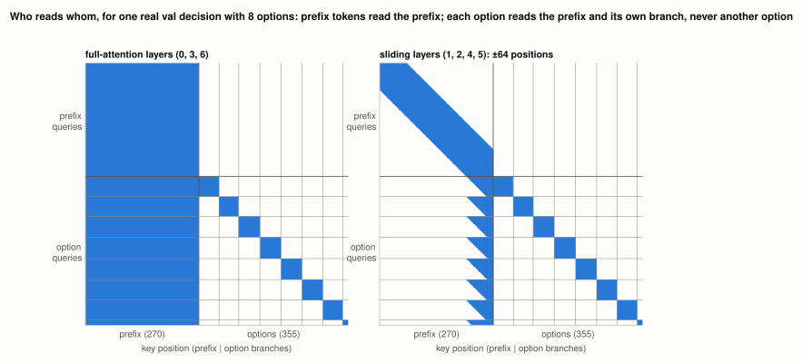
</picture></p>

## 3. Which layers become the loop

The layer types are `F S S F S S F` (F = full attention, S = sliding):

```
layer:   0   1   2   3   4   5   6
type:    F   S   S   F   S   S   F
         ^   \_______/   \_______/
     outside  block A     block B   (same pattern: S S F)
```

- **Layers 1–3 and 4–6 already share one pattern**, (sliding, sliding, full). Tying them changes no mask,
  window or RoPE table. A looped model with this block is still a legal ModernBERT config: layer 0 plus the
  block n times is `1 + 3n` layers whose types the existing loader accepts.
- **Layer 0 stays outside the loop.** It has no attention norm, so it computes a different function shape
  and cannot be one of the repeated layers. It acts as the loop's input encoder.
- **Block size 3, two loops** is the only choice that both covers layers 1–6 and keeps a repeating
  attention pattern. `loops_of(layer_types, block)` checks this and refuses anything else.

The edited model computes:

```
h0 = embed(tokens)
h1 = layer0(h0)
h2 = BLOCK(h1)        # layers 1, 2, 3
h3 = BLOCK(h2)        # the same three layers again (stored as layers 4, 5, 6)
logits = head(mean_pool(final_norm(h3)))
```

The architecture figure below is drawn from the real config and weights:

- **Original (left):** seven distinct layers. Layers 1–6 have 557,568 parameters each; layer 0 has 557,312,
  since it lacks the 256 attention-norm gains.
- **Looped (right):** the block of layers 1–3 is boxed. Loop 2 is drawn dashed because it holds no weights
  of its own, only the block's.

<p align="center"><picture>
  <source media="(prefers-color-scheme: dark)" srcset="figures/loop-edit/architecture-dark.svg">
  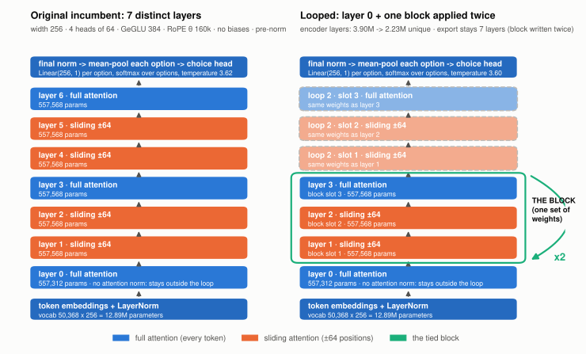
</picture></p>

## 4. Step 1: exact rewrites that change no output

Two blocks trained independently are not directly comparable, even if they compute similar things.
Transformers have **gauge symmetries**: many different weight settings compute exactly the same function.
Averaging or comparing blocks without first aligning them mixes unrelated coordinates. Step 1 therefore
rewrites the weights into a common gauge without changing the function. `teacher_weights()` does this, and the
run asserts that the rewritten model's KL to the original is at most 1e-6 (measured: 4e-10).

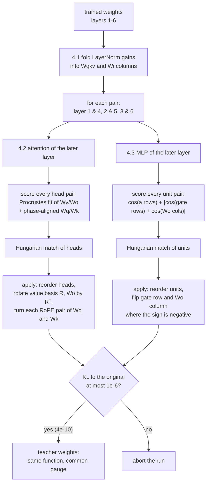

### 4.1 Fold LayerNorm gains into the next Linear

ModernBERT's LayerNorm has a gain `g` and no bias: `LN(x) = g ⊙ n(x)`, with `n` the normalisation. The
Linear that reads it has no bias either, so:

```
W · (g ⊙ n(x)) = (W · diag(g)) · n(x)
```

`fold_norms()` multiplies the columns of `attn.Wqkv` by `attn_norm.weight` and the columns of `mlp.Wi` by
`mlp_norm.weight`, then sets both gains to ones. This applies to layers 1–6; layer 0 has no attention norm. The
function is identical, and the per-layer gains no longer differ between the blocks, so they need no tying.

### 4.2 Re-gauge each attention layer of block B onto block A

For each pair (layer 1+j, layer 4+j), `align_attention()` applies three symmetries, all exact:

1. **Head permutation.** Heads are summed after `Wo`, so their order is arbitrary. For every (head a of A,
   head b of B) a similarity score is computed. The Hungarian algorithm
   (`scipy.optimize.linear_sum_assignment`) picks the matching that maximises total similarity.
2. **Value-basis rotation, per head.** The head output is `Wo_h · (A · V_h)`, where `V_h = Wv_h x` and `A` is
   the attention pattern. For any orthogonal `R` (64 x 64), replacing `Wv_h → R Wv_h` and `Wo_h → Wo_h Rᵀ`
   gives `Wo_h Rᵀ R Wv_h = Wo_h Wv_h`, so the output is unchanged. `R` is the orthogonal Procrustes solution
   that best maps B's stacked (value rows, output columns) onto A's: `R = U Vᵀ` from the SVD of
   `[Wv_a | Wo_aᵀ] · [Wv_b | Wo_bᵀ]ᵀ`.
3. **Query/key phase rotation, per RoPE pair.** RoPE (rotate-half form) pairs dimension `j` with `j + 32`.
   Read each pair as one complex number. The rotary embedding multiplies pair `j` by `e^{i θ_j p}` at position
   `p`, and the attention score is `q · k = Re Σ_j q_j conj(k_j)`. Multiplying pair `j` of **both** `Wq_h`
   and `Wk_h` by the same unit phase `e^{i φ_j}`:
   - commutes with the rotary rotation, since both are complex multiplications;
   - leaves every score unchanged, since `e^{iφ}` and `conj(e^{iφ})` cancel.

   This is a 32-parameter family of exact symmetries per head (one phase per pair). The best phase per pair
   is the argument of `Σ_rows (q_a conj(q_b) + k_a conj(k_b))`. A general rotation of the q/k space would not
   commute with RoPE; only these per-pair phases do.

The head-matching score is the normalised Procrustes fit of the value/output weights plus the normalised
magnitude of the phase-aligned q/k inner product. After matching, B's rows are reordered and rotated in place.

The head-matching matrices below show this score for every head pair; boxes mark the Hungarian match.

- **The match is not obvious, and is not the identity.** Most rows have several heads within a few hundredths
  of each other. Layers 1 vs 4 match heads (0, 1, 2, 3) to (3, 2, 1, 0).
- **Layers 3 and 6 are the least alike.** Their pair has the lowest similarities.

<p align="center"><picture>
  <source media="(prefers-color-scheme: dark)" srcset="figures/loop-edit/head-match-dark.svg">
  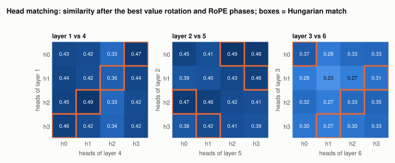
</picture></p>

### 4.3 Re-gauge each MLP of block B onto block A

GeGLU computes `Wo · (gelu(a) ⊙ gate)` with `(a, gate) = split(Wi x)`. `align_mlp()` uses two symmetries:

1. **Neuron permutation.** Reordering the 384 hidden units consistently in both halves of `Wi` and the
   columns of `Wo` is exact.
2. **Gate sign flip.** Negating a unit's gate row and its `Wo` column is exact, since `(−gate)` times `(−Wo)`
   cancels. The `a` row cannot be flipped, because `gelu` is not odd.

The matching cost is the cosine similarity of the `a` rows plus the absolute value of the summed cosine
similarities of the gate rows and `Wo` columns. The sign of that sum decides the flip. The Hungarian
algorithm picks the permutation.

The figure below shows the full 384 x 384 matching cost for each layer pair.

- **Top row (as trained):** noise. Unit i of one layer has no special relation to unit i of the other.
- **Bottom row (after re-ordering):** a clear diagonal. Most units of layer 1+j have a recognisable partner in
  layer 4+j. The diagonal is weakest for layers 3 vs 6, matching the head picture.
- **Gate flips:** 195, 181 and 179 of 384 gate signs were flipped. About half is what an arbitrary sign
  convention would give: training has no reason to prefer one sign.

<p align="center"><picture>
  <source media="(prefers-color-scheme: dark)" srcset="figures/loop-edit/neuron-match-dark.svg">
  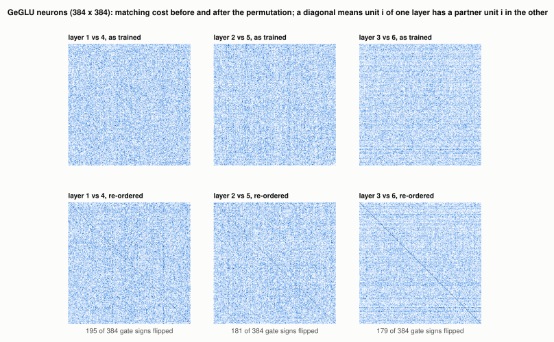
</picture></p>

### 4.4 Is the alignment correct?

- **The rewrite is exact.** On 400 held-out decisions the rewritten model's KL to the original is
  **−3.8e-10**, a float rounding of zero. Top-1 agreement and Spearman correlation are both 1.0.
- **The alignment finds the right gauge.** `test_regauge_recovers_a_scrambled_copy` builds layers 4–6 as a
  scrambled copy of layers 1–3: swapped heads, random orthogonal value rotations, random RoPE phases, permuted
  and sign-flipped MLP units. Aligning must return them to layers 1–3 to 1e-8, and it does.

**How alike the blocks become.** The figure below shows the cosine similarity of each weight matrix of layer
1+j against layer 4+j, as trained and after the re-gauge. The function is identical in both panels; only the
coordinates change.

- **As trained:** every similarity is 0.00 to two decimals. Without alignment the blocks look unrelated, which
  is why the unaligned mean is the worst tie in [Section 7.1](#71-every-variant-ranked-on-held-out-train-maps-400-decisions).
- **After alignment, `Wv` is the most similar (0.30–0.46).** Its gauge is the freest: a full 64 x 64 rotation
  per head is fitted. Part of that similarity is the fit itself, not shared structure.
- **The other matrices:** `attn Wo` reaches 0.15–0.25 and the MLP matrices 0.11–0.15.
- **`Wq` and `Wk` stay near 0.06.** Only one phase per RoPE pair is free there, far less than a rotation.
- **Takeaway:** the blocks share real but partial structure, so a plain weight copy or mean cannot keep the
  function, and the activation-aware ties are needed.

<p align="center"><picture>
  <source media="(prefers-color-scheme: dark)" srcset="figures/loop-edit/weight-similarity-dark.svg">
  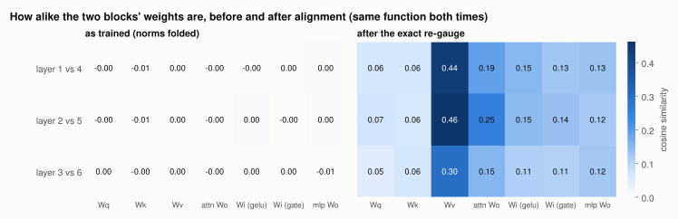
</picture></p>

## 5. Step 2: tying the blocks

After Step 1 both blocks are in one gauge, and every variant below writes **one** set of weights into
both. `is_looped()` checks that each variant is bit-identical across the two loops before it is scored.

The whole `rh17m loop-edit` run:

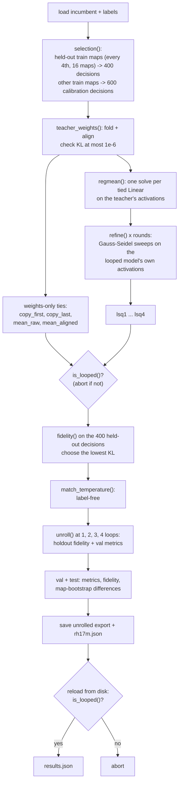

### 5.1 Weights-only ties (no data)

| Variant | What it does |
|---|---|
| `copy_first` | block A's weights in both loops |
| `copy_last` | block B's weights in both loops |
| `mean_raw` | element-wise mean of A and B, **without** alignment (norms still folded): the naive merge |
| `mean_aligned` | element-wise mean of A and B after alignment |

### 5.2 Activation-aware ties (unlabelled calibration inputs, no gradient)

Both fits use **calibration activations**: the hidden states the models produce on 600 unlabelled decisions
from training maps (see [Section 6](#6-data-splits-and-how-a-variant-is-chosen)). No label is read, and nothing
is differentiated. Every solve is a closed-form ridge least squares, accumulated in fp32 on the GPU and solved
in float64:

```
W = C · (G + λ · tr(G)/d · I)⁻¹,   G = Σ x xᵀ (input Gram),   C = Σ y xᵀ (target-input cross moment)
```

Sums run over valid tokens only: prefix tokens before `prefix_len`, and option tokens with `doc_seg ≥ 0`.
Padding never enters. `λ` is the relative ridge, 1e-3 by default.

`walk()` re-implements the forward pass sub-layer by sub-layer and exposes these taps:

| Tap | Meaning |
|---|---|
| `x` | stream entering the layer |
| `attn_in` | its normed copy |
| `qkv` | `Wqkv` output, before RoPE |
| `att` | merged head outputs |
| `mid` | stream after attention |
| `mlp_in` | normed copy of `mid` |
| `ag` | `Wi` output |
| `h` | `gelu(a) ⊙ gate` |
| `out` | stream leaving the layer |

A unit test checks that `walk()` reproduces `model(batch)` to 1e-5.

**What each tied Linear is fitted to** (`FIT` in the code):

| Linear | Input (from the model being fitted) | Target (from the unedited, re-gauged model) |
|---|---|---|
| `attn.Wqkv` | `attn_in` | `qkv` |
| `attn.Wo` | `att` | `mid − x` (the residual update needed) |
| `mlp.Wi` | `mlp_in` | `ag` |
| `mlp.Wo` | `h` | `out − mid` |

For the two output projections the target is the update that would bring the **fitted model's own stream**
back to the original's at that depth. So the output projections also absorb drift that earlier layers
left behind.

**`regmean`** (after Jin et al.'s RegMean merging) solves each tied Linear once, on the **original** model's
activations. Each depth keeps its own inputs and targets, and one weight fits both:

```
W_tied = (Σ_p C_p) (Σ_p G_p + ridge)⁻¹     over p ∈ {layer 1+j, layer 4+j}
```

This is the least-squares weight that best reproduces both layers on their own inputs. It ignores the fact
that, in the looped model, loop 2's inputs come from the tied loop 1 rather than the original layers 1–3.

**`lsq<r>`** fixes that with **Gauss-Seidel sweeps** (`refine()`). Starting from `regmean`, the 12 tied
Linears are visited in forward order (`Wqkv`, `Wo`, `Wi`, `Wo` for slot 1, then slots 2 and 3). Each is
re-solved on the **looped model's current activations** at both depths and written back before the next one
is measured. `lsq<r>` is the state after `r` full sweeps.

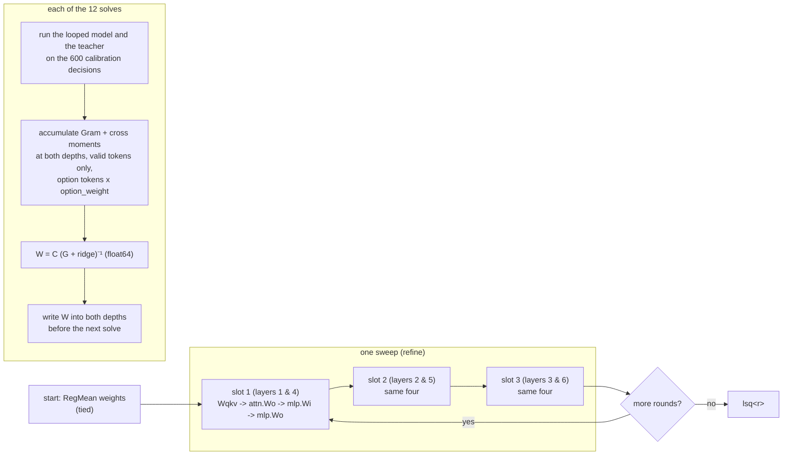

**Where the drift happens.** The figure below shows the relative error of the looped model's residual stream
on option tokens, against the original's, after each layer, on the 400 held-out decisions. The stream is
gauge-invariant (Step 1 only moves things inside a layer), so it compares directly with the original.

| Variant | Loop 1 | After layer 6 |
|---|---|---|
| Copy layers 1–3 (weights only) | exactly the original | 0.38 |
| RegMean | 0.04 to 0.12 | 0.23 |
| RegMean + 4 sweeps (chosen) | less error than RegMean (0.07 against 0.12 after layer 3) | 0.12 |

- **The copy is exact in loop 1** because its weights there are the original layers 1–3. All its error appears
  in loop 2, where block A's weights stand in for B's.
- **RegMean spreads the error over both loops.**
- **The sweeps are below RegMean at every layer.** Against the copy they accept a small error in loop 1 to
  keep loop 2 on track: their output projections absorb the drift the earlier layers leave behind.

<p align="center"><picture>
  <source media="(prefers-color-scheme: dark)" srcset="figures/loop-edit/stream-error-dark.svg">
  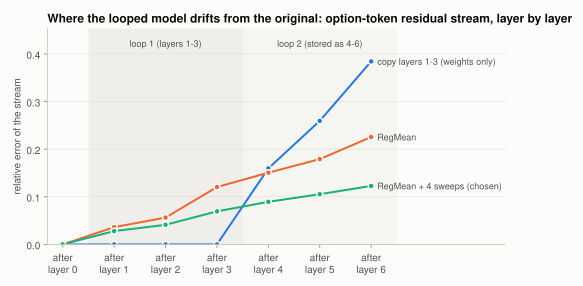
</picture></p>

<p align="center"><picture>
  <source media="(prefers-color-scheme: dark)" srcset="figures/loop-edit/sweeps-dark.svg">
  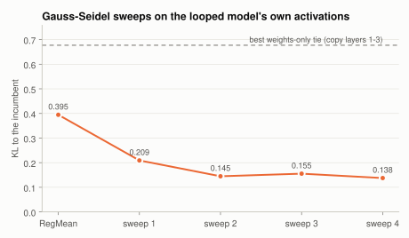
</picture></p>

**Option weight.** Option tokens are far fewer than prefix tokens, yet only option tokens reach the head.
Each option token's Gram and cross moment can be multiplied by `option_weight`. The final run uses 6, chosen
by holdout KL; see the tuning history for how small that edge was.

**Identifiability.** Inputs to `Wqkv` and `Wi` are layer-normed, so they have zero mean across the hidden
dimension. Those weights are only determined up to a component along the all-ones vector, and the ridge picks
the minimum-norm one. The unit test that recovers a known tied weight compares the two after centring.

### 5.3 Things tried and removed

- **Re-solving the `choice` head.** A closed-form refit of the head weight on per-decision centred logits made
  holdout KL slightly worse: 0.152 against 0.147 at option weight 1, and 0.155 against 0.138 at option
  weight 6. It was removed from the code.

## 6. Data, splits and how a variant is chosen

Labels: `data/labels`, 2,619 files, of which 2,247 build into examples under the default `DatasetConfig`
(train 1,633, val 398, test 204, ood 12). Splits are by map (`dataset.map_split`):

- `-dev-` maps are test;
- `-ood-` maps are ood;
- `arena-train-0227/0228/0229` plus a hashed eighth of the other train maps are val;
- the rest are train.

| Use | Source | Size |
|---|---|---|
| Calibration activations (no labels read) | train decisions **not** on the held-out train maps, seed 0 | 600 decisions |
| Choosing a variant (no labels read) | train decisions on every 4th train map in sorted order (16 of 62 maps), seed 0 | 400 decisions |
| Final report (labels read) | val (10 maps) and test (29 maps) | 398 and 204 decisions |

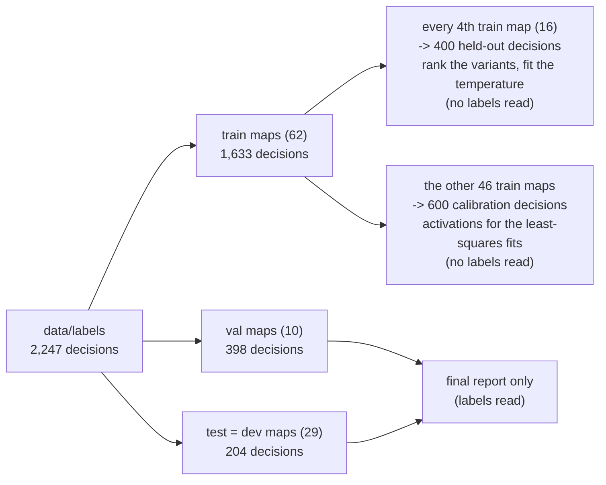

**Why choose on fidelity rather than val regret.** The goal is that the looped model keeps the incumbent's
behaviour. Fidelity to the incumbent needs no labels and measures that goal directly. Val is effectively about
10 maps, three of which hold 373 of its 398 decisions, so it cannot resolve the differences between variants.

Fidelity metrics (`fidelity()`), per decision, averaged:

- `kl`: KL(incumbent ‖ edited) of the raw option distributions;
- `top1`: the same top option;
- `spearman`: rank correlation of the option probabilities, for decisions with 3 or more options.

**The chosen variant is the lowest holdout `kl`.**

**Caveat on the holdout.** The held-out decisions are from training maps, which the incumbent was trained on;
the calibration inputs come from the other training maps. Holdout fidelity is a selection device, not a
generalisation estimate. The val/test fidelity in [Section 7.3](#73-what-the-labels-say) is the honest number,
and it is worse (KL 0.19, not 0.14).

**Temperature.** The edited model gets its own temperature, `match_temperature()`. This is the value at which
its tempered distribution is closest in KL to the incumbent's tempered distribution on the holdout. It needs no
labels. Result: 3.597, against the incumbent's 3.624. Val/test metrics use each model at its own temperature.
`regret`, `play_regret`, `capture` and `hit` depend only on the option order, so the temperature cannot move
them.

**Intervals.** Every looped-minus-incumbent interval in the report is a 95% percentile bootstrap that resamples
**whole maps** (`evaluate.cluster_bootstrap_diff`, 2,000 draws, seed 0). The older `bootstrap_diff` resamples
single decisions, which is too narrow when decisions from one map are correlated; that was audit finding 1 on
2026-11-10. The new function is used only by the loop edit; the climb still uses the old one.

## 7. Results

All numbers are from `runs/loop/1023-1627-base-s1-loop2/results.json` (2026-11-21, M4 Max, MLX 0.32.4,
Python 3.12.10, 513 s end to end).

### 7.1 Every variant, ranked on held-out train maps (400 decisions)

| Variant | Uses activations? | KL to incumbent | Top-1 agreement | Spearman |
|---|---|---|---|---|
| (re-gauged, untied: must be exact) | – | −0.0000000004 | 1.000 | 1.000 |
| `copy_first` | no | 0.677 | 0.625 | 0.816 |
| `copy_last` | no | 0.758 | 0.330 | 0.458 |
| `mean_raw` | no | 0.885 | 0.228 | 0.488 |
| `mean_aligned` | no | 0.837 | 0.385 | 0.605 |
| `regmean` | yes | 0.395 | 0.492 | 0.798 |
| `lsq1` | yes | 0.209 | 0.590 | 0.850 |
| `lsq2` | yes | 0.145 | 0.647 | 0.882 |
| `lsq3` | yes | 0.155 | 0.635 | 0.883 |
| **`lsq4` (chosen)** | yes | **0.138** | 0.632 | **0.885** |

<p align="center"><picture>
  <source media="(prefers-color-scheme: dark)" srcset="figures/loop-edit/variants-dark.svg">
  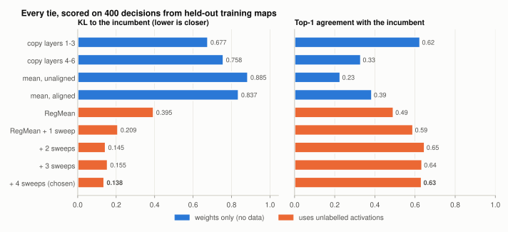
</picture></p>

What this shows:

- **Alignment matters for merging.** `mean_aligned` beats `mean_raw` on every fidelity metric. The raw mean
  mixes unrelated heads and neurons.
- **Plain averaging is worse than copying.** Both means lose to `copy_first`, so the two blocks are not close
  enough for an average to stay inside either one's function.
- **Block A carries more of the behaviour than block B.** Keeping A (`copy_first`) is much closer than keeping
  B (`copy_last`): top-1 0.625 against 0.330.
- **Activation-aware fitting is the big step.** RegMean halves the KL of the best weights-only tie, and the
  sweeps halve it again. Sweeps plateau after 2 (0.145, 0.155, 0.138): the remaining movement is noise in the
  procedure, not steady progress.

### 7.2 It is a real loop: the same block at other loop counts

`unroll()` writes the chosen block any number of times. With n loops the model has 1 + 3n layers:

| Loops | Layers | Holdout KL | Holdout top-1 | Val regret | Val play_regret |
|---|---|---|---|---|---|
| 1 | 4 | 0.737 | 0.568 | 0.345 | 0.337 |
| **2** | **7** | **0.138** | 0.632 | 0.336 | 0.333 |
| 3 | 10 | 0.146 | 0.653 | 0.347 | 0.344 |
| 4 | 13 | 0.148 | 0.648 | 0.353 | 0.350 |

The val columns here use the raw probabilities. Regret depends only on the option order, so the temperature
does not matter for these two columns.

- **The second pass does the work.** One pass is far from the incumbent (KL 0.737); two passes bring it to
  0.138. This separates a loop transformer from a 4-layer model that merely shares weights on disk.
- **Extra loops are stable but do not help.** Loops 3 and 4 stay close to the incumbent (KL 0.146, 0.148,
  slightly higher top-1) and do not blow up. Many looped models diverge past their trained loop count, and
  Yang et al. add input injection for that reason. Val regret drifts up slightly with more loops. Nothing was
  trained to use more loops, so no gain was expected.

<p align="center"><picture>
  <source media="(prefers-color-scheme: dark)" srcset="figures/loop-edit/loops-dark.svg">
  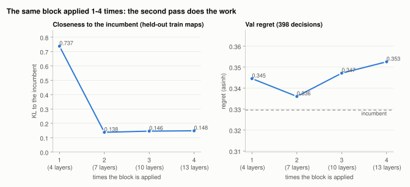
</picture></p>

**Past the fitted loop count.** `rh17m loop-figures` runs the block up to 8 times.

- **KL drifts only slowly:** 0.138 at 2 loops, 0.146, 0.148, 0.149, 0.151, 0.154, then 0.158 at 8.
- **Top-1 agreement edges up:** from 0.63 to 0.66.
- **The representation is settling.** The change in the option states per extra loop shrinks steadily: 0.54
  (1 to 2 loops), then 0.17, 0.10, 0.087, 0.076, 0.066, 0.058. That is the behaviour of a map approaching a
  fixed point, not of one that diverges.

Nothing here was trained to make extra loops useful, so this shows that it is safe to run more loops, not
that it helps.

<p align="center"><picture>
  <source media="(prefers-color-scheme: dark)" srcset="figures/loop-edit/fixed-point-dark.svg">
  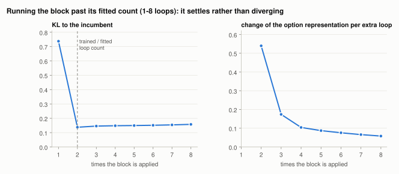
</picture></p>

### 7.3 What the labels say

**Fidelity on held-out maps:**

| Split | Decisions | Maps | KL | Top-1 agreement | Spearman |
|---|---|---|---|---|---|
| val | 398 | 10 | 0.186 | 0.578 | 0.786 |
| test | 204 | 29 | 0.190 | 0.593 | 0.828 |

**Decision quality**, each model at its own temperature. Rows are model by split:

| | regret | play_regret | exp_regret | capture | hit | nll | ece |
|---|---|---|---|---|---|---|---|
| val, incumbent | 0.330 | 0.325 | 0.387 | 0.139 | 0.294 | 2.253 | 0.127 |
| val, looped (`lsq4`) | 0.336 | 0.333 | 0.377 | 0.139 | 0.276 | 2.261 | 0.101 |
| val, `copy_first` (weights only) | 0.341 | 0.327 | 0.395 | 0.088 | 0.284 | – | – |
| test, incumbent | 0.423 | 0.408 | 0.490 | 0.092 | 0.294 | 2.217 | 0.120 |
| test, looped (`lsq4`) | 0.443 | 0.422 | 0.494 | 0.090 | 0.319 | 2.225 | 0.133 |
| test, `copy_first` (weights only) | 0.499 | 0.479 | 0.485 | 0.014 | 0.279 | – | – |

The `copy_first` rows use raw probabilities, so its `exp_regret` is not comparable with the tempered rows.

**Looped minus incumbent**, with a 95% map-bootstrap interval (positive means the looped model is worse):

| Split | regret | play_regret | exp_regret |
|---|---|---|---|
| val | +0.007 [−0.046, +0.030] | +0.009 [−0.044, +0.026] | −0.011 [−0.033, +0.005] |
| test | +0.020 [−0.024, +0.073] | +0.014 [−0.027, +0.059] | +0.004 [−0.008, +0.018] |

<p align="center"><picture>
  <source media="(prefers-color-scheme: dark)" srcset="figures/loop-edit/regret-dark.svg">
  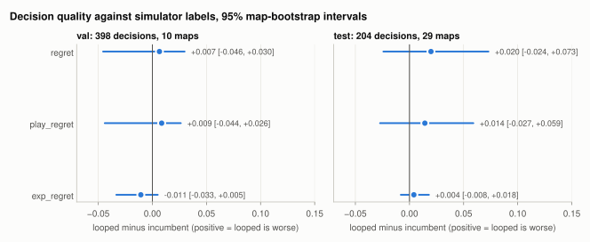
</picture></p>

**Option by option.** The scatter below compares the two models' centred log-probabilities for every option of
every val decision. Each point is one option, with the decision's mean log-probability subtracted.

- **The models broadly agree:** Pearson r = 0.85.
- **Their top picks often differ:** they match in 58% of decisions. Many decisions have several options within
  a small margin of each other, so small changes swap the leader.

<p align="center"><picture>
  <source media="(prefers-color-scheme: dark)" srcset="figures/loop-edit/logits-dark.svg">
  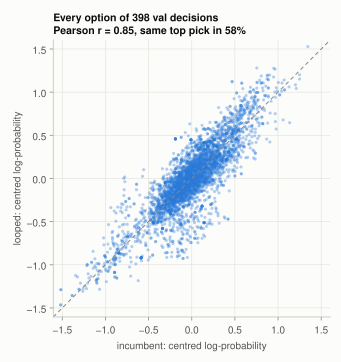
</picture></p>

How to read this:

- **No difference is significant on either split.** But "not significant" is weak evidence here. On val, the
  one-loop 4-layer model (0.345) and the weights-only copy (0.341) also sit close to the incumbent's 0.330.
  Val cannot separate any of these models.
- **Test separates more.** The weights-only copy is clearly worse there (0.499 against 0.423). The chosen edit
  is 0.443, with an interval that spans zero but leans worse.
- **The incumbent has little edge to lose.** On the closed-loop devhub suite it was +0.171 asinh over random,
  not significant (README). On test, `capture` is only 0.09. Many different option orders score about the same.
- **Incumbent numbers differ from `results.json` (n=128).** The incumbent's val regret here is 0.330, not the
  0.210 in its own `results.json`. Val has since grown from 128 to 398 decisions (labels from later passes and
  label versions), so the incumbent is re-evaluated on today's examples and paired decision by decision.

### 7.4 Parameters

| | Before | After (unique values) |
|---|---|---|
| All parameters | 16,798,211 | 15,125,507 |
| Encoder-layer parameters | 3,902,720 | 2,230,016 |

The export is stored **unrolled** at 7 layers, so the file is not smaller. The block is written twice, which
keeps every existing loader, runtime and `rh17m play` path working unchanged. "Unique" counts layer 0, one
block, the embeddings and the heads.

<p align="center"><picture>
  <source media="(prefers-color-scheme: dark)" srcset="figures/loop-edit/parameters-dark.svg">
  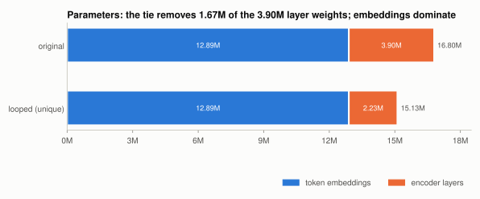
</picture></p>

## 8. Verification

| Check | How | Result |
|---|---|---|
| The re-gauge changes no output | KL of the rewritten model to the original on 400 decisions; the run aborts above 1e-6 | −3.8e-10 |
| The alignment recovers a known gauge | unit test on a scrambled copy | equal to 1e-8 |
| Every variant is tied | `is_looped()` before scoring; the run aborts otherwise | all 9 tied |
| The saved export is tied | reload from disk, `is_looped()`; the run aborts otherwise | `tied_after_reload: true` |
| The published PyTorch runtime loads it | `reference.load_reference(export)`: SentenceTransformers `strict=True` | loads |
| PyTorch and MLX agree on the export | `reference.parity`, 16 cases (choice, noul, score; both layouts) | max \|p_mlx − p_torch\| 1.13e-6; token ids equal in all cases |
| PyTorch sees the tie | `torch.equal` on all 6 tensors of layer 1 against layer 4 | true |
| `walk()` is the real forward pass | unit test against `model(batch)` | 1e-5 |
| Least squares returns a weight that is already tied | unit test (`ridge` 1e-9, compared after centring for normed inputs) | 5e-3 |
| Activation ties beat copying | unit test on a random 7-layer model | `lsq` error < both copies |
| Map bootstrap spans maps, not decisions | unit test (two maps with means 1 and 3) | interval [1, 3] |
| Determinism | final run vs the identical sweep run before it | `lsq4` KL 0.13753523 in both |

Unit suite: `pytest -q tests/unit`, 165 passed (153 before plus 12 new). `ruff check` is clean on every
touched file.

## 9. Tuning history (every run made)

All runs use the incumbent `runs/train/1023-1627-base-s1/model`. Only the last run's directory is kept; the
others were deleted after reading.

| Run | Calib | Holdout | Rounds | Option weight | Best holdout KL | Notes |
|---|---|---|---|---|---|---|
| `smoke` | 32 | 48 | 1 | 1 | `lsq1` 0.160 | plumbing check, 34 s |
| `sweep-c600-r6` | 600 | 400 | 6 | 1 | `lsq5` 0.146 | lsq1–6: 0.187, 0.153, 0.149, 0.147, 0.146, 0.147; plateau after 2–3 |
| `sweep-ow1-r4` | 600 | 400 | 4 | 1 | `lsq4` 0.147 | head refit 0.152 (worse) |
| `sweep-ow6-r4` | 600 | 400 | 4 | 6 | `lsq4` 0.138 | lsq1–4: 0.209, 0.145, 0.155, 0.138; head refit 0.155 (worse) |
| **`1023-1627-base-s1-loop2`** | 600 | 400 | 4 | 6 | `lsq4` 0.138 | final; head refit code removed; same numbers as the sweep |

- **Option weight 6 is not a finding.** It won by 0.009 KL (0.138 against 0.147), while successive sweeps of
  one run move by 0.01–0.02.
- **Val and test were printed during tuning.** Every choice (variant, number of sweeps, option weight, head
  refit) was made on the held-out train-map KL, and the val/test numbers did not drive any of them.

## 10. Reproduce

```bash
cd ~/railhead-17m
.venv/bin/python -m pytest -q tests/unit/test_loopedit.py

# The final edit (about 9 minutes on an M4 Max; uses the GPU, no simulator, no gradient steps)
.venv/bin/rh17m loop-edit --name 1023-1627-base-s1-loop2 \
    --model runs/train/1023-1627-base-s1/model --calib 600 --rounds 4 --option-weight 6
# -> runs/loop/1023-1627-base-s1-loop2/{config.json, results.json, model/}
```

The run prints one JSON line per stage: split sizes, re-gauge exactness, timings, every variant's holdout
fidelity, the loop-count table, then val and test.

Flags: `--calib` (calibration decisions, default 384), `--holdout` (default 400), `--rounds` (Gauss-Seidel
sweeps, default 3), `--ridge` (default 1e-3), `--option-weight` (default 1), `--seed`, `--labels`, `--out`
(default `runs/loop`).

Using the export:

```python
from rh17m import bekko_mlx as B
model = B.load("runs/loop/1023-1627-base-s1-loop2/model", revision=None)   # MLX
# PyTorch: rh17m.bekko_mlx.reference.load_reference(<same path>)
```

```bash
.venv/bin/rh17m play --tasks ... --policies model --model runs/loop/1023-1627-base-s1-loop2/model
```

`rh17m play` reads the temperature from `rh17m.json` (3.597). `rh17m_bekko_mlx.json` records the provenance:
source model, variant, the loop layout (`block_layers [1, 2, 3]`, `loops 2`, `layer0_outside`) and the
temperature.

Running the block a different number of times (not saved by default):

```python
from rh17m import loopedit as L
src = B.load("runs/loop/1023-1627-base-s1-loop2/model", revision=None)
w, types = L.unroll(L.weights(src), src.config.layer_types, block=3, loops=3)   # 10 layers
looped3 = L.rebuild(src, w, types)
B.save(looped3, "runs/loop/loop3/model")   # a 10-layer ModernBERT export
```

Regenerating the figures (about 2 minutes on an idle M4 Max; needs the `viz` extra):

```bash
uv pip install -e '.[viz]'
.venv/bin/rh17m loop-figures --run runs/loop/1023-1627-base-s1-loop2   # -> docs/figures/loop-edit/
RH17M_FIG_PREVIEW=/tmp/prev .venv/bin/rh17m loop-figures --run ...     # also write PNG previews
```

## 11. Code map

`src/rh17m/loopedit.py`:

| Function | Role |
|---|---|
| `weights`, `rebuild` | parameters ↔ dict of float64 arrays; rebuild a `BekkoMLX` with any schedule |
| `loops_of` | checks that the schedule is layer 0 + block × loops |
| `fold_norms` | exact: LayerNorm gains into the next Linear |
| `align_attention` | exact: head permutation, per-head value rotation, per-RoPE-pair q/k phases |
| `align_mlp` | exact: GeGLU neuron permutation and gate sign |
| `teacher_weights` | fold + align: the original function in the tying gauge |
| `tie` | weights-only ties: `first`, `last`, `mean` |
| `walk` | forward pass with sub-layer taps (verified equal to `model(batch)`) |
| `solve_tied` | ridge least squares of one weight shared across depths, over valid prefix and option tokens |
| `regmean` | every tied Linear solved on the original model's activations |
| `refine` | one Gauss-Seidel sweep on the looped model's own activations |
| `unroll` | the first block at any loop count |
| `is_looped`, `unique_parameters` | the tie check and parameter accounting |
| `fidelity`, `match_temperature` | label-free comparison with the incumbent |
| `LoopConfig`, `run` | the pipeline behind `rh17m loop-edit` |

Other changes:

- `src/rh17m/evaluate.py`: `cluster_bootstrap_diff`, which resamples whole maps.
- `src/rh17m/cli.py`: the `loop-edit` and `loop-figures` subcommands.
- `src/rh17m/loopviz.py`: every figure in this document (see [Section 15](#15-figures-and-how-they-are-made)).
- `pyproject.toml`: a `viz` extra (matplotlib, pillow).
- `.gitignore`: `runs/loop/*/model/`.

## 12. Limitations and threats to validity

- **No closed-loop result.** The gate (`rh17m gate`) and `rh17m play` need the simulator, and the pipeline has
  been paused since 2026-10-24. Offline val gains did not transfer to closed loop before (README, distillation
  finding), so offline parity is not closed-loop parity.
- **The model is different.** About 4 in 10 val/test decisions get a different top pick. Regret is not
  significantly worse, but the evaluation that says so has wide intervals.
- **Calibration and selection are on training maps.** They are disjoint sets of maps, but the incumbent was
  trained on both. Val/test fidelity (KL 0.19) is the generalisation number.
- **The chosen edit is not data-free.** It reads hidden activations of 600 unlabelled training decisions. The
  best edit from weights alone is `copy_first`; it is not saved, but the code produces it.
- **The search for the best tie is not exhaustive.** Options not tried:
  - partial ties (attention only, or MLP only);
  - per-loop LayerNorm gains (cheap, and papers use them);
  - an input-injection scalar (Closing the Loop);
  - other block choices, such as a 2-layer block with layer 6 outside.

  Each would change what counts as "a loop" and was left out to keep the edit a strict loop.
- **Known evaluation issues still apply.** From the 2026-11-10 audit:
  - val mixes seven label versions;
  - tycoon labels use a 365-day run-off where the tasks say 730.

  Both models are scored on the same decisions, so the comparison is paired, but absolute numbers inherit
  these problems.

## 13. What to do next

1. **Retrofit fine-tune from this export.** Train with the tie kept (one shared block, gradients summed across
   loops), 3 seeds plus the A/A control, against the unlooped incumbent. This is the loop papers' recipe; the
   weight edit gives it a better start than copying.
2. **Train with loop-count sampling** (1–4 loops per batch) and supervise each loop's output. Only then can
   extra loops at test time improve anything.
3. **Closed-loop check**, after the evaluation fixes (gate off the test maps, map bootstrap in the climb):
   `search:3` with the looped model against its random control.
4. **Cheap ablations that need no training:** per-loop gains, an input-injection scalar, attention-only ties.

## 14. References

Opened and read at abstract level on 2026-11-21:

- Yang, Lee, Nowak, Papailiopoulos. *Looped Transformers are Better at Learning Learning Algorithms.*
  ICLR 2024. arXiv:2311.12424
- Rusch, Seyde, Boyer, Patterson, Rus. *Looped Actor: Depth-Recurrent Reasoning Models for Reinforcement
  Learning.* arXiv:2609.37432
- Xiong et al. *Truncate or Not? A Scaling Study of Looped Transformers with Truncated Backpropagation.*
  arXiv:2610.26030
- Marchenko et al. *Closing the Loop: Practical Training Recipes for Looped Language Models.*
  arXiv:2610.00673
- McLeish et al. *Teaching Pretrained Language Models to Think Deeper with Retrofitted Recurrence.*
  arXiv:2511.07384
- Li, Li, Zhou. *Skip a Layer or Loop it? Test-Time Depth Adaptation of Pretrained LLMs.* arXiv:2507.07996
- Zhang, Hu, Peng, Xie. *When Does Recurrence Become an Algorithm? Convergence Selection in Weight-Tied
  Looped Transformers.* arXiv:2607.20594
- Park, Rusch. *Looped Reasoning Finishes Earlier Than You Think.* arXiv:2610.18174

Method background (not re-read for this work):

- Jin, Ren, Preotiuc-Pietro, Cheng. *Dataless Knowledge Fusion by Merging Weights of Language Models*
  (RegMean). ICLR 2023. arXiv:2212.09849
- Ainsworth, Hayase, Srinivasa. *Git Re-Basin: Merging Models modulo Permutation Symmetries.* ICLR 2023.
  arXiv:2209.04836
- Dehghani et al. *Universal Transformers.* ICLR 2019. arXiv:1807.03819
- A curated list of about 235 looped-transformer papers: github.com/Mrkkew/Awesome-Loop-Transformers

## 15. Figures and how they are made

`rh17m loop-figures --run <loop-edit run>` (`src/rh17m/loopviz.py`) writes every figure. Each SVG has a light
and a dark version (`<name>.svg`, `<name>-dark.svg`), and the markdown picks one with `<picture>`. Colours
follow the dataviz reference palette:

- three categorical slots in fixed order, validated for colour-blind separation in both modes;
- a one-hue blue ramp for magnitudes;
- ink colours for text and a hairline grid.

The figures come from two kinds of source:

- **Results** are read from `results.json`, so the run itself is not repeated.
- **Measurements** load the incumbent and the export and compute fresh numbers. They are saved to
  `docs/figures/loop-edit/measurements.json`.

| File | Kind | What it shows | Source |
|---|---|---|---|
| `trajectory.gif` | media | one val decision's 8 options moving through the layers, original vs looped, in a shared 2-D projection | measured |
| `architecture.svg` | model visualization | both models drawn from the config: layer types, windows, parameter counts, the tied block | config + weights |
| `attention-masks.svg` | model visualization | the real full and sliding attention layouts for one decision (prefix block, option branches) | `BekkoMLX._masks` |
| `head-match.svg` | model visualization | 4 x 4 head similarity per layer pair, with the Hungarian match | measured (weights) |
| `neuron-match.svg` | model visualization | 384 x 384 GeGLU matching cost before and after the permutation | measured (weights) |
| `weight-similarity.svg` | model visualization | cosine similarity of each weight matrix between the blocks, before and after the re-gauge | measured (weights) |
| `stream-error.svg` | graph | residual-stream error per layer for copy, RegMean and the chosen tie | measured (400 held-out decisions) |
| `fixed-point.svg` | graph | KL and per-loop representation change for 1-8 loops | measured (400 held-out decisions) |
| `logits.svg` | graph | centred log-probabilities, incumbent vs looped, all val options | measured (val) |
| `variants.svg` | graph | KL and top-1 of every tie | `results.json` |
| `sweeps.svg` | graph | KL after RegMean and each Gauss-Seidel sweep | `results.json` |
| `loops.svg` | graph | KL and val regret at 1-4 loops | `results.json` |
| `regret.svg` | graph | looped minus incumbent on val/test with map-bootstrap intervals | `results.json` |
| `parameters.svg` | graph | parameter breakdown before and after the tie | `results.json` |

The flowcharts in this document are Mermaid blocks, which GitHub renders in place.
